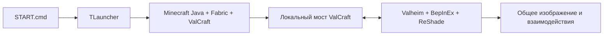

# ValCraft — Minecraft внутри Valheim

<p align="center">
  <strong>Valheim × Minecraft Java · TLauncher Setup</strong><br>
  Установка, запуск, проверка и откат интеграции на Windows
</p>

<p align="center">
  
  
  
  
  
</p>

**ValCraft** объединяет два игровых мира: Minecraft Java запускается отдельным процессом, а его блоки, предметы и взаимодействия отображаются внутри Valheim. Можно строить из блоков, разрушать окружение инструментами Minecraft и переключаться между управлением Minecraft и Valheim.

**Этот репозиторий — адаптация установщика [оригинального ValCraft](https://github.com/strangemap/valcraft) для TLauncher**, а не самостоятельная разработка игрового движка и не официальный релиз ValCraft. Вместо Prism Launcher используется локальный профиль TLauncher. Игра Minecraft здесь не входит в комплект: нужны легально полученные копии игр и соответствующий доступ.

> [!WARNING]
> **Экспериментальная сборка.** В архиве нет подтверждённого теста установки на другом компьютере. Используйте отдельные сохранения, сделайте резервную копию мира Valheim и закройте игры перед установкой. Не публикуйте свои игровые сохранения или пользовательские файлы.

## Навигация

- [Возможности](#возможности)
- [Требования](#требования)
- [Быстрый старт](#быстрый-старт)
- [Управление](#управление)
- [Скрипты и файлы](#скрипты-и-файлы)
- [Как работает](#как-работает)
- [Удаление и восстановление](#удаление-и-восстановление)
- [Ошибки и диагностика](#ошибки-и-диагностика)
- [Лицензия и авторы](#лицензия-и-авторы)

## Возможности

- **Minecraft внутри Valheim:** блоки, взаимодействие с миром, предметы и оружие Minecraft.
- **Переключение режимов:** управляйте Minecraft или обычным персонажем Valheim.
- **Физическое взаимодействие:** построенные блоки учитываются системой столкновений Valheim; оружие Minecraft воздействует на существ.
- **Сценарии в один клик:** отдельные команды для установки, запуска, проверки файлов и отката изменений.
- **Локальный профиль TLauncher:** `ValCraft-26.3-Fabric`, без замены существующих обычных миров Minecraft.
- **Контроль целостности:** некоторые загружаемые файлы проверяются по хешам; `CHECK.cmd` проверяет наличие основных компонентов и настройки профиля.

## Требования

| Компонент | Необходимо |
|---|---|
| Система | Windows 10/11, PowerShell 5.1, интернет при первой установке |
| Valheim | Установленная ПК-версия с `valheim.exe`, запуск в DirectX 11 |
| BepInEx | **Уже установлен** в Valheim (`BepInEx\core\BepInEx.dll`) |
| Minecraft | Minecraft Java Edition с действительным доступом |
| Лаунчер | Установленный **TLauncher**; запуск Minecraft в нём вручную |
| Minecraft-профиль | Minecraft **26.3**, Fabric Loader **0.19.5**, Fabric API |
| Java | **Java 25** для Minecraft 26.3 (лаунчер может скачать её при первом запуске) |
| Память | Скрипт выделяет Minecraft до **4 ГБ RAM**; Valheim требует память отдельно |

Перед установкой убедитесь, что Valheim, Minecraft и TLauncher закрыты.

## Быстрый старт

**1. Получите файлы.** Скачайте этот репозиторий через **Code → Download ZIP**, распакуйте в отдельную папку (не в папку Valheim). Нужны все файлы, включая каталог `upstream`.

**2. Установите BepInEx.** Если в Valheim ещё нет `BepInEx\core\BepInEx.dll`, сначала установите совместимую версию BepInEx для Valheim. Сам этот установщик BepInEx не устанавливает.

**3. Установите интеграцию.** Запустите `INSTALL.cmd`. В типичной Steam-установке скрипт ищет Valheim в `C:\Program Files (x86)\Steam\steamapps\common\Valheim`, а TLauncher в `%APPDATA%\.minecraft\TLauncher.exe`. При ошибке доступа к папке Valheim запустите `INSTALL.cmd` от имени администратора.

**4. Запустите игры.** Откройте `START.cmd`. В TLauncher выберите **`ValCraft-26.3-Fabric`** и нажмите кнопку запуска Minecraft. **Это ручной шаг:** автоматическое нажатие кнопки TLauncher не реализовано. Когда Minecraft откроет канал связи, скрипт запустит Valheim с `-force-d3d11`.

**5. Проверьте.** Создайте для теста отдельный мир и персонажа Valheim. Нажмите **R**, чтобы переключить режимы. Если не видно блоков, попробуйте **F7**.

> [!TIP]
> Если Steam или TLauncher установлены не в стандартных папках, смотрите [туториал с настройкой путей](docs/TUTORIAL.md#нестандартные-пути-к-играм). Выбранные пути сохраняются локально и не должны попадать в Git.

**[Полный туториал с настройкой, первым запуском и решением ошибок →](docs/TUTORIAL.md)**

## Управление

| Клавиша | Действие |
|---|---|
| **R** | Режим Minecraft ↔ режим Valheim |
| **ЛКМ / ПКМ** | Атака / разрушение, использование / установка блока |
| **1–9 / колёсико** | Панель быстрого доступа Minecraft |
| **E** | Инвентарь Minecraft или взаимодействие с объектом Valheim |
| **Ctrl / Shift** | Бег / приседание в режиме Minecraft |
| **F5** | Изменение вида камеры |
| **Двойной пробел** | Полёт в творческом режиме |
| **F3 + F4** | Выбор режима игры Minecraft |
| **F6** | Показ/скрытие рук |
| **F7** | Включить/отключить ValCraft |
| **F8** | Выровнять сетку блоков |
| **F9** | Творческий ↔ выживание |

Поведение клавиш зависит от текущего режима и может конфликтовать с назначениями Valheim или других модов.

## Скрипты и файлы

```text
valcraft-tlauncher-setup/
├── README.md                 # Описание и быстрый старт
├── INSTALL.cmd               # Установка профиля и мода
├── START.cmd                 # Запуск TLauncher → Minecraft → Valheim
├── CHECK.cmd                 # Проверка файлов
├── RESTORE.cmd               # Откат изменений Valheim
├── ValCraft-TLauncher.ps1    # Основной сценарий Windows
├── upstream/
│   ├── README.md             # Документация исходного проекта (Prism-версия)
│   ├── LICENSE               # Оригинальная лицензия
│   ├── install-valheim.ps1    # Установка части Valheim
│   └── files/                # Компоненты ValCraft (не файлы Minecraft)
├── docs/
│   ├── TUTORIAL.md           # Полная инструкция
│   └── TROUBLESHOOTING.md    # Диагностика
├── LICENSE
└── .gitignore
```

`runtime/`, `backup-before-valcraft/`, `installed-tlauncher.json` и `valcraft.local.json` создаются **локально** при использовании. Они исключены из Git. Релиз **не включает** Minecraft, пользовательские сохранения или загруженный установщик ReShade.

## Как работает



Minecraft работает отдельным процессом. ValCraft передаёт данные о камере, блоках и столкновениях между играми; ReShade накладывает Minecraft на кадр Valheim. `START.cmd` ждёт открытия локального моста Minecraft (порт `25599`), затем запускает Valheim. Текущая сборка рассчитана прежде всего на экспериментальное использование, включая одиночную игру.

## Удаление и восстановление

1. Закройте обе игры и TLauncher.
2. Запустите **`RESTORE.cmd`**.
3. Проверьте Valheim обычным способом.

Откат восстанавливает оригинальные изменённые файлы Valheim из `backup-before-valcraft/` или убирает добавленные установщиком файлы. **Профиль Minecraft, скачанные файлы и миры не удаляются.** Храните резервную копию до успешного восстановления.

## Ошибки и диагностика

Сначала выполните `CHECK.cmd`. Он проверяет файлы и настройки, **но не доказывает, что игра работает без ошибок**. Основные журналы:

- `runtime\minecraft\logs\latest.log` — Minecraft.
- `Valheim\BepInEx\LogOutput.log` — плагин BepInEx.
- `Valheim\ReShade.log` — графическая интеграция.

Возможные причины: неверная версия профиля, Java не 25, отсутствующий BepInEx, другая папка игры, Valheim в Vulkan вместо DirectX 11 или конфликт с другим модом.

**[Открыть подробную диагностику →](docs/TROUBLESHOOTING.md)**

## Лицензия и авторы

Оригинал: **[strangemap/valcraft](https://github.com/strangemap/valcraft)**, релиз `v0.1.0`, лицензия MIT. Лицензионные уведомления исходного проекта сохранены в [`LICENSE`](LICENSE) и [`upstream/LICENSE`](upstream/LICENSE). Использованы идеи и наработки [universal-modder](https://github.com/rehan-remade/universal-modder); см. [оригинальный README](upstream/README.md).

[ReShade](https://reshade.me), [Fabric](https://fabricmc.net), [BepInEx](https://github.com/BepInEx/BepInEx), Minecraft и Valheim принадлежат соответствующим разработчикам. **Сборка не аффилирована с Mojang, Microsoft, Iron Gate, ReShade или TLauncher.** Сторонние компоненты могут иметь отдельные лицензии.

> Этот репозиторий распространяет адаптацию сценариев установки и разрешённые компоненты ValCraft, а не установочные файлы самих игр.
